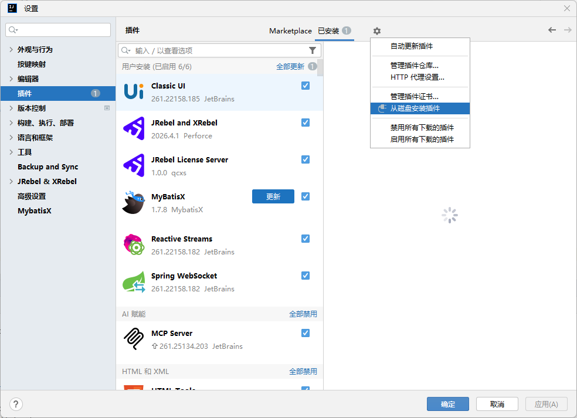
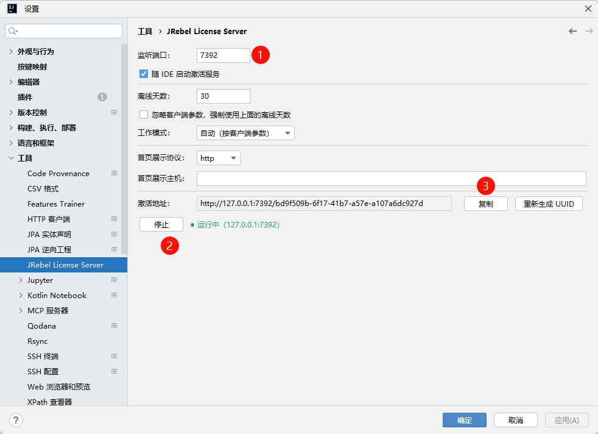
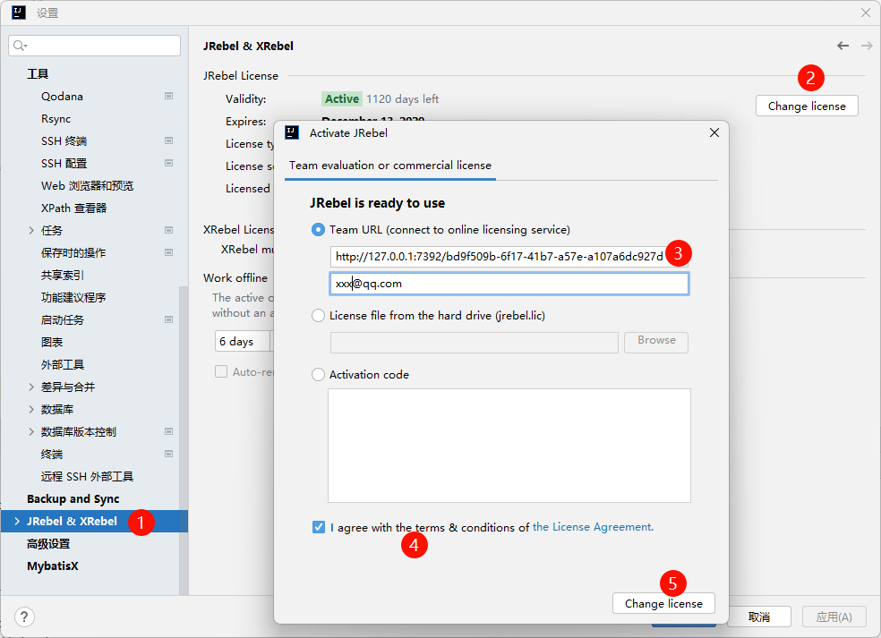
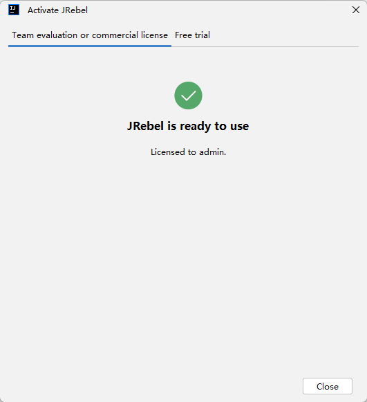

# JRebel License Server (IntelliJ IDEA Plugin)

在 IntelliJ IDEA 进程内直接运行 JRebel / XRebel 激活服务，随 IDE 启动与关闭，无需额外部署独立的服务端进程。

> 项目地址：<https://github.com/qcxs/jrebel-license-server-idea-plugin>

本项目是 [jrebel-license-active-server](https://github.com/yu-xiaoyao/jrebel-license-active-server)（Go 版）的 Kotlin 移植版本，HTTP 接口、响应结构和签名方式与 Go 版保持一致。

> 二改 / 维护：qcxs；原作者：[yu-xiaoyao](https://github.com/yu-xiaoyao/jrebel-license-active-server)。

> 本项目仅供本地开发、学习与个人便利使用，请勿用于商业用途。有条件请支持 JRebel / XRebel 正版授权。

## 使用教程

1、release下载插件包

2、idea插件列表，选择从磁盘安装，安装后启用（可能需要重启idea）



3、“设置”-》“工具”-》“Jrebel License Server”，修改端口-》启动-》复制激活地址（勾选“随IDE启动激活服务”）



4、“设置”-》“JRebel & XRebel”，激活-》输入复制的激活地址（邮箱任意）—》同意条款-》确定



5、稍等半刻，激活完成



## 功能特性

- 内嵌 HTTP 服务，默认监听 `127.0.0.1:12345`，端口可在设置中修改
- 支持 JRebel 2018.1+ 的 UUID 激活地址，以及 JRebel 7.1 及更早版本的 token 激活地址
- 可配置离线天数、工作模式（自动 / 强制离线 / 强制在线 / 旧版 GUID）、首页展示地址
- 保留 `/rpc/*` 旧版 Atlassian 协议接口（`ping` / `obtainTicket` / `releaseTicket`）
- 状态栏常驻显示运行状态，右键可复制激活地址、重新生成 UUID、启停、重启、打开设置
- Tools 菜单提供「复制激活地址」「启动/停止激活服务」两个动作
- 设置通过 `jrebel-license-server.xml` 持久化，随 IDE 配置目录保存

## 为什么做成 IDE 插件？

与「独立服务器进程」方案相比，两种形态各有取舍：

### 优点

1. **零部署**：安装插件即完成，无需下载可执行文件、配置开机自启或手动启动服务。
2. **生命周期自然**：服务随 IDE 启动而启动、随 IDE 退出而关闭，不会残留后台进程或占用端口。
3. **配置与状态统一**：端口、离线天数、工作模式等在 IDE 设置页中维护，状态栏和控制台日志统一在 IDE 内查看。
4. **分发简单**：按 IDE 版本提供两个插件 zip，均无需区分操作系统与 CPU 架构（旧版包依赖 JBR 11，新版包依赖 JBR 17+）。
5. **地址稳定**：UUID 与端口持久化保存，激活地址在多次重启后保持不变。
6. **安全边界清晰**：只绑定回环地址 `127.0.0.1`，不向局域网暴露。

### 缺点

1. **强依赖 IDE**：IDE 未运行时服务不可用；IDE 卡顿、崩溃或重启会一并影响服务。
2. **平台版本耦合**：依赖 IntelliJ Platform API（旧版包 `sinceBuild=212`，新版包 `sinceBuild=223`），IDE 大版本升级后可能需要适配。
3. **只能单机自用**：服务绑定回环地址，无法为团队、其他机器或 CI 提供激活，也不能远程访问。
4. **端口冲突**：默认端口被占用时需要手动改端口；修改端口会短暂重启服务。
5. **更新需随 IDE**：插件升级通常需要重启 IDE（或重新安装）才能生效，不如独立进程热替换方便。
6. **运行环境受限**：无法运行在没有 IDE 的服务器、容器或纯命令行环境中；日志混在 IDE 日志里，排查相对不便。

**适用场景**：个人本机、单个 IDE、追求「装完即用」的场景。若需要团队共享、远程访问或独立部署，应使用 Go 版的独立服务端。

## 环境要求

项目同时发布两个产物，按 IDE 版本选择安装：

| 产物 | 适配 IDE 版本 | 字节码 | 说明 |
| --- | --- | --- | --- |
| `jrebel-license-server-idea-plugin-legacy-<version>.zip` | **2021.2 – 2022.2**（build 212–222.*） | Java 11 | 编译基线 2021.3.3，面向运行在 JBR 11 上的旧版 IDE |
| `jrebel-license-server-idea-plugin-<version>.zip` | **2022.3（build 223）及以上** | Java 17 | 编译基线 2023.3.4，使用现代动作线程 API |

- 构建统一使用 JDK 17（Toolchain 17）
- 两包均覆盖对应区间的所有正式版；新版包不设置 `untilBuild` 上限
- 旧版包已在 **2021.2（IU-212.5080.55）**、**2021.3.3（IU-213.7172.25）** 上验证；新版包在 **2023.3.4** 上验证
- 两个产物功能一致，仅编译基线、兼容区间、字节码版本与动作线程实现不同
- 同一个 IDE 中需安装官方 JRebel 插件

> 插件版本号固定为 `1.0.0`，仅用于界面显示，不代表发布版本；安装时不校验版本高低，允许低版本直接覆盖已安装的高版本。

## 构建

```bash
# 新版包（2022.3+，Java 17）
.\gradlew.bat buildPlugin                 # Windows
./gradlew buildPlugin                     # macOS / Linux

# 旧版包（2021.2–2022.2，Java 11，使用 Gradle IntelliJ Plugin 1.x + 2021.3.3 编译）
.\gradlew.bat -p legacy buildPlugin       # Windows
./gradlew -p legacy buildPlugin           # macOS / Linux
```

Windows 下可直接运行 `build.bat`，一次构建两个版本。

产物：

- 新版：`build/distributions/jrebel-license-server-idea-plugin-<version>.zip`
- 旧版：`legacy/build/distributions/jrebel-license-server-idea-plugin-legacy-<version>.zip`

在沙箱 IDE 中调试运行：

```bash
.\gradlew.bat runIde               # 新版（2023.3.4）
.\gradlew.bat -p legacy runIde     # 旧版（2021.3.3）
```

CI（`.github/workflows/build.yml`）会同时构建两个产物，并随 Release 一并发布。

## 安装

1. 打开 IDE：`Settings` → `Plugins` → 齿轮菜单 → `Install Plugin from Disk...`
2. 按上表选择对应产物：2021.2–2022.2 用 legacy 包，2022.3+ 用新版包
3. 重启 IDE

## 使用

1. 在 `Settings` → `Tools` → `JRebel License Server` 中确认端口、离线天数等配置
2. 通过以下任一方式获取激活地址：
   - 点击状态栏的 `JRebel :12345`，选择「复制激活地址」
   - 菜单 `Tools` → `JRebel: 复制激活地址`
   - 浏览器打开 `http://127.0.0.1:12345/` 首页查看并复制
3. 打开官方 JRebel 插件（`JRebel & XRebel` 设置），将激活服务器地址填为上一步复制的内容（邮箱可任意填写）
4. 访问 `http://127.0.0.1:12345/` 能看到服务首页即表示运行正常

激活地址格式：

```text
http://127.0.0.1:{port}/{uuid}
```

## 配置项

配置持久化在 IDE 配置目录下的 `jrebel-license-server.xml`。

| 配置项 | 默认值 | 说明 |
| --- | --- | --- |
| 监听端口 `port` | `12345` | 仅监听 `127.0.0.1` |
| 离线天数 `offlineDays` | `30` | 离线许可证的有效天数 |
| 忽略客户端天数 `ignoreOfflineDays` | `false` | 强制使用上面的离线天数 |
| 工作模式 `workMode` | `0` | `0` 自动（按客户端参数）/ `1` 强制离线 / `2` 强制在线 / `3` 旧版 GUID |
| 首页展示协议 `exportSchema` | `http` | 首页展示地址使用的协议 |
| 首页展示主机 `exportHost` | 空 | 留空时按请求的 Host 推断 |
| 随 IDE 启动 `autoStart` | `true` | IDE 启动时自动拉起服务 |
| UUID `uuid` | 随机 | 激活地址的后缀，可在设置页或状态栏重新生成 |

## HTTP 接口

| 路径 | 说明 |
| --- | --- |
| `/jrebel/leases`、`/agent/leases` | 2018.1+ 的 lease 接口（SHA1withRSA 签名） |
| `/jrebel/leases/1`、`/agent/leases/1` | lease 接口的兼容变体 |
| `/jrebel/validate-connection` | 连接校验 |
| `/rpc/ping.action` | 旧版 Atlassian 协议 ping（MD5withRSA 签名） |
| `/rpc/obtainTicket.action` | 旧版协议获取 ticket |
| `/rpc/releaseTicket.action` | 旧版协议释放 ticket |
| 其他路径 | 返回服务首页 |

签名私钥位于 `src/main/resources/keys/`，与 Go 版保持一致。

## 项目结构

```text
src/main/kotlin/com/yuxiaoyao/jrebel/license/
├── LicenseServerService.kt        # 应用级服务，管理 HTTP 服务生命周期与状态监听
├── LicenseServerNotifications.kt  # 通知封装
├── server/                        # 内嵌 HTTP 服务、响应体、签名、首页渲染
├── settings/                      # 持久化配置与设置页
├── startup/                       # IDE 启动监听
└── ui/                            # 状态栏组件
src/main/resources/
├── META-INF/plugin.xml            # 插件声明
├── keys/                          # RSA 私钥
└── web/index.html                 # 首页模板
src/modern/kotlin/.../action/      # 新版动作（实现 ActionUpdateThread）
src/legacy/kotlin/.../action/      # 旧版动作（不实现 ActionUpdateThread）
legacy/                            # 旧版独立构建脚本
```

## 相关项目

- [jrebel-license-active-server](https://github.com/yu-xiaoyao/jrebel-license-active-server) —— 本项目的 Go 版原始实现
